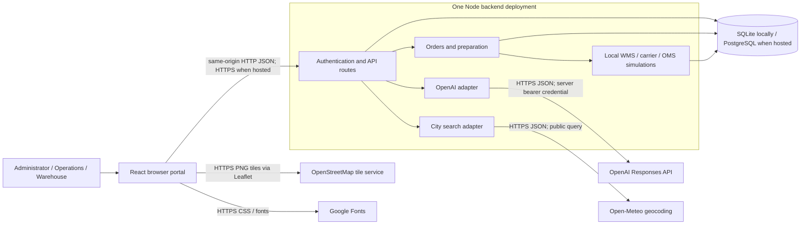

# TranceLogix — Final Integration Artifact

**As-built review date:** 20 November 2026  
**Team Sync:** Jacob Rethrick Abad, Francine Jace Bachiller, Eirene Joan Dela Cruz, Kyle Bryan Quintos  
**Application baseline:** `ec58659241302b46a3e6c846faaf0a98614c4e2b`; validation feature committed as `1e584f6`. The accompanying documentation is an additional review artifact. No application behavior was changed for this report.

This AI-assisted artifact consolidates the supplied proposal, Technical 2–4 submissions, Module 7 RMMM register, repository source, and new measurements. The proposal remains the requirements baseline; source and measurements establish what is actually delivered. A requirement that is absent from the implementation remains a gap. The team must verify the analysis, supply its own contribution statements, and approve residual risks before submission.

## Evidence and source conventions

| ID | Supplied artifact | Use in this report |
| --- | --- | --- |
| S1 | `Abad-Bachiller-Dela-Cruz-Quintos_20260923_154657_0000 (3).pdf` | Original logistics proposal, especially pp. 5–10. |
| S2 | `IT0129_FE_FINAL_Final_Project_Artifact_and_Defense_31345935.docx` | Final Parts A–F, demonstration and defense criteria. |
| S3 | `IT0129_M4T1_Technical_2_Software_Construction_Testing_and_Integration (1).docx` | Technical 2 assignment brief, distinguished from the team's implementation evidence. |
| S4 | `Team-Sync-Group-Review (1).pdf` | Peer review of HOTKICKS, a different student project. Its results are not TranceLogix results or an independent industry case study. |
| S5 | `TEAM-SYNC-GW3_GROUPWORK.pdf` | Original 22 risk IDs, response plans, triggers and monitoring responsibilities. |
| S6 | `TEAM-SYNC-TECHNICAL-4.pdf` | Release plan, nine historical local test results, and qualified risk closure. |
| S7 | `TeamSync_TECH2 (1).pdf` | Integration contracts, architecture comparison, targets and nine reported local tests. |
| S8 | `TeamSync_TECH3 (1).pdf` | Original Python reusable validator, maintenance analysis and AI corrections. |

Hashes and page counts are in [the source manifest](../evidence/source-manifest.json). PDF page references use the supplied PDF page order. A separate corrected Technical 1 deliverable was not supplied: the diagrams below reconstruct and correct S1 using S7 and the current source; they are not presented as the missing original submission.

| Evidence | Meaning |
| --- | --- |
| [Integration validation](../evidence/integration-validation.json) | Reproducible local load, eight injected provider faults, and shipment recovery measurements. All provider traffic in this run was synthetic. |
| [Live adapter verification](../evidence/live-services.json) | One real fixed-message OpenAI diagnostic and one real public city lookup. No customer records, identity or conversation sent. |
| [Regression results](../evidence/regression-tests.log) | Existing backend, PostgreSQL-semantics, Netlify, location and theme checks. |
| [Build log](../evidence/build.log), [type check](../evidence/typecheck.log) | Fresh build and type-check output. An empty type-check log with exit code 0 means success; exit codes are recorded in the evidence manifest. |
| [Evidence manifest](../evidence/validation-manifest.json) | Check outcomes and file hashes for the delivered evidence and relevant source. |

## Part A — Working integrated system

### Delivered boundary and business process

TranceLogix is a logistics operations portal with a React frontend, one Node.js backend, persistent storage, three account roles, order capture, inventory checks, preparation, shipment creation, tracking, activity history, account administration, maps and an optional AI assistant. It is a modular monolith with hosting adapters, rather than independently deployed OMS, WMS and carrier microservices.

The implemented business workflow is: authenticate → create an order → check example stock → record picking, packing, weight and shortages → create a simulated carrier shipment → retain its tracking reference → retry OMS synchronization if required → inspect saved tracking and activity. Shipment creation represents a label/booking record; it does not prove dispatch or delivery. Inventory checks do not reserve or deduct stock.

| System/service | Actual exchange | Delivery evidence |
| --- | --- | --- |
| Portal browser ↔ Node API | Authenticated JSON requests and saved operational records. | Existing regression checks and source in [backend.ts](../server/backend.ts), [api.ts](../src/api.ts). |
| Node API ↔ SQLite / PostgreSQL | Parameterized SQL for users, sessions, orders, preparation, shipments, activity and rate limits. SQLite is local; managed PostgreSQL is required by hosted adapters. | SQLite tests and PostgreSQL-semantics tests. The latter use PGlite, not a live Neon network connection. |
| Node adapter ↔ OpenAI Responses API | Server-authenticated HTTPS JSON; chat assistance or a fixed diagnostic. | Live diagnostic HTTP 200, 4,308.74 ms on 20 November. This proves a live capability exchange, not every record-aware conversation. |
| Node adapter ↔ Open-Meteo geocoding | HTTPS city query → validated location candidates. | Public Tarlac City lookup HTTP 200, 1,230.87 ms on 20 November. |
| Leaflet browser map ↔ OpenStreetMap tiles | Anonymous HTTPS PNG tile requests around the selected city. | Implemented browser component and earlier preview inspection; no tile load benchmark was performed for this report. |
| OMS, WMS and carrier functions | Local workflow simulations and database updates. | Explicit simulation flags, repeat-request and recovery tests. No live warehouse lookup, carrier booking, carrier credentials or provider callback exists. |

The application therefore exchanges capability with at least two real external services, OpenAI and Open-Meteo. **The proposal's independent OMS–WMS–carrier business integration is not fully delivered.** If assessment acceptance specifically requires two independent logistics business systems, the external utility integrations do not establish that requirement; real logistics adapters and acceptance evidence remain necessary.

Integration is appropriate for geocoding, maps and AI because the application can consume maintained specialist capabilities without building geographic datasets, a tile service or a language model. In the original logistics design, integration would preserve existing order, warehouse and carrier ownership. The delivered local simulations do not demonstrate that preservation across independent organizations.

### Source, dependencies and configuration

The repository is the source-code delivery. [package.json](../package.json) is the dependency manifest and [pnpm-lock.yaml](../pnpm-lock.yaml) fixes the dependency graph. Tested runtime: Node.js 24.21.0; package manager: pnpm 10.11.0. Locked principal versions include React/React DOM 19.2.4, Vite 8.0.5, TypeScript 5.9.3, Tailwind 4.2.2, Leaflet 1.9.4, `pg` 8.23.1 and `serverless-http` 4.0.0. SQLite is provided by Node's `node:sqlite`; PGlite 0.5.16 is a test dependency.

| Location | Responsibility |
| --- | --- |
| [src/App.tsx](../src/App.tsx), [WorkspacePages.tsx](../src/WorkspacePages.tsx) | Public entry, authentication and workspace navigation/views. |
| [server/backend.ts](../server/backend.ts) | HTTP routes, authentication, role checks and logistics orchestration. |
| [server/storage.ts](../server/storage.ts), [database.ts](../server/database.ts) | SQLite/PostgreSQL adapter, schema, seeding and transactional persistence. |
| [server/chat.ts](../server/chat.ts), [locations.ts](../server/locations.ts) | External API adapters and response/error handling. |
| [netlify.toml](../netlify.toml), [netlify/functions/api.ts](../netlify/functions/api.ts) | Netlify build and same-origin API function routing. |
| [.env.example](../.env.example), [Netlify guide](netlify-setup.md) | Variable names, local/hosted setup and troubleshooting; no private values required in source. |

### Run after cloning

Install Node.js 24, open a terminal in the cloned repository, and run:

```sh
corepack enable
corepack pnpm@10.11.0 install --frozen-lockfile
corepack pnpm@10.11.0 dev
```

Open the address printed by Vite, normally `http://localhost:8443`. This starts the frontend and API together. A fresh local checkout needs no separately installed database and no cloud credentials for its logistics demonstration. It creates its own Git-ignored `.data/trancelogix.sqlite`; it does not copy another user's database. Existing local databases retain existing credentials and data.

| Fresh local demo role | Email | Initial example password |
| --- | --- | --- |
| Administrator | `admin@trancelogix.local` | `TranceLogixDemo!2026` |
| Operations staff | `operations@trancelogix.local` | `TranceLogixDemo!2026` |
| Warehouse staff | `warehouse@trancelogix.local` | `TranceLogixDemo!2026` |

These public example credentials apply to newly seeded local databases. Netlify uses accounts in its connected PostgreSQL database and disables demo seeding. Login allows ten attempts per IP per fifteen-minute window; reuse a session during a demonstration instead of repeatedly signing in.

For the built local server, copy `.env.example` to a private `.env.local`, retain `SEED_DEMO_DATA=true` for local examples, then run:

```sh
corepack pnpm@10.11.0 build
corepack pnpm@10.11.0 start
```

Open `http://127.0.0.1:3000`. Uploading only `dist/` to static hosting does not run the backend. Keep `.env.local` private and Git-ignored. Optional AI needs the panel's own server-side `OPENAI_API_KEY`; `OPENAI_MODEL` defaults to `gpt-6-luna`. A configured key does not guarantee model access or billing credit. Maps require internet access but no embedded map key for the current public-service setup. Local photos remain in the project.

Hosted setup requires a private pooled PostgreSQL `DATABASE_URL`, bootstrap administrator email/password for a new empty database, and optional AI variables with Functions access. Bootstrap credentials do not reset an existing account. Netlify configuration is documented and locally tested; this report did not redeploy or verify the current production site or hosted database.

### Reproduce the evidence and demonstrate the app

```sh
corepack pnpm@10.11.0 test:backend
corepack pnpm@10.11.0 test:postgres
corepack pnpm@10.11.0 test:netlify
corepack pnpm@10.11.0 test:locations
corepack pnpm@10.11.0 test:theme
corepack pnpm@10.11.0 exec tsc --noEmit
corepack pnpm@10.11.0 build
corepack pnpm@10.11.0 validate:integration
```

The last command binds a temporary loopback server, seeds an isolated in-memory database, sends no real provider requests, and takes roughly 80 seconds including the implemented 30-second and 7-second deadlines. It does not touch the preview database. Results vary with hardware and background load. To preserve supplied measurements, pass `--output=evidence/local-rerun.json`.

Optionally run `corepack pnpm@10.11.0 verify:live` after privately configuring a key. This sends one small billable OpenAI diagnostic and one public city lookup through the real adapter modules. It saves statuses/timing without credentials or provider bodies. It is not a load test and does not verify the entire browser-to-hosted-database path.

Suggested demonstration: log in, create a uniquely named order using a listed SKU, verify stock, complete preparation, and select the simulated timeout. Show that an immediate blind shipment retry is blocked. Check carrier status, select the simulated synchronization failure, and retry synchronization only. Confirm the same shipment/tracking reference and one shipment for the order. Open a city map and the administrator's assistant connection test. Show JSON from `/api/health` and the saved fault-injection evidence. Use a local demonstration database for induced failures.

## Part B — Integration documentation

### Corrected integration models

S1 p. 6 labels multiple downstream boxes as OMS. The current model distinguishes internal functions from independent services and avoids implying nonexistent network calls. S1's carrier-return arrow is a synchronous response in the present implementation; no inbound carrier webhook route is implemented.



```mermaid
sequenceDiagram
  actor Operator
  participant UI as Browser
  participant API as Node middleware
  participant DB as Workspace database
  Operator->>UI: Create order
  UI->>API: POST /api/v1/orders + session + verification header
  API->>API: Validate fields, SKU and quantities; authorize role
  API->>DB: Transaction: order + preparation + activity
  API-->>UI: 201 {order}
  UI->>API: POST /api/v1/inventory/check {orderId}
  API->>DB: Read example stock; save availability
  API-->>UI: 200 {available, simulation:true, order}
  UI->>API: PUT preparation (picked, packed, weight, shortage, notes)
  API->>DB: Save preparation
  UI->>API: POST shipments {orderId, carrier, simulation}
  API->>DB: Transaction: prerequisites, unique shipment and outcome
  alt Simulated unknown carrier outcome
    API-->>UI: 409 outcome_unknown; confirmation required
    UI->>API: POST carrier/check before retry
  else Simulated shipment confirmed / OMS sync fails
    API-->>UI: 201 saved shipment; sync Pending
    UI->>API: POST shipments/:id/sync
    API->>DB: Update existing shipment synchronization only
    API-->>UI: 200 same shipment and tracking reference
  end
```

Data ownership is currently one database: `orders`, `preparations`, `inventory`, `shipments`, `carrier_requests`, `users`, `sessions`, `activity`, `rate_limits`. Unique order IDs, shipment order IDs, tracking references and idempotency keys constrain duplicates. This is a local transaction boundary, not a distributed transaction or evidence of carrier-side at-most-once execution.

### Integration point register — contracts and access

All JSON mutations require `Content-Type: application/json` and `X-TranceLogix-Request: 1`. Origin is checked when present. Legacy branding aliases remain accepted. Session cookies are HttpOnly, SameSite=Strict, eight hours, and Secure in hosted adapters.

| ID | Boundary / interface | Protocol and format | Authentication and authorization |
| --- | --- | --- | --- |
| IP01 | Browser ↔ `/api/auth/session`, `/login`, `/logout` | Same-origin HTTP locally / HTTPS hosted; JSON and cookie headers. | Password + database session; public login; logout revokes the presented session. |
| IP02 | Browser/OMS-style client ↔ `/api/v1/orders`, `/:id`, `/workspace` | HTTP(S) REST-style JSON. Create uses `items[].quantity`; saved records use `items[].qty`. | Session; create: administrator/operations. Reads: all authenticated roles. No independent OMS service credential. |
| IP03 | Browser ↔ `/api/v1/inventory/check`, `/orders/:id/preparation`; internal stock check | HTTP(S) JSON to API; local SQL/in-process simulation thereafter. | Session; all three roles may check stock and save preparation. |
| IP04 | Browser ↔ `/api/v1/shipments`, `/carrier/check`, `/shipments/:id/sync`; local carrier/OMS functions | HTTP(S) JSON; in-process simulation and SQL, with no outbound carrier/OMS protocol. | Session; administrator/operations may create, check carrier outcome and synchronize. |
| IP05 | Browser ↔ `/api/v1/tracking?reference=...` | HTTP(S) GET and saved-record JSON. | Session; all roles. No provider callback authentication because no callback exists. |
| IP06 | Browser ↔ `/api/v1/profile`, `/password`, `/users`, `/users/:id[/role]` | HTTP(S) JSON. | Own profile/password; administrator-only other-account management. Self deletion/role change and last-admin safeguards. |
| IP07 | Node ↔ database | Local SQLite API/file or PostgreSQL wire protocol through `pg`; parameterized SQL; JSON text columns. | Local filesystem access or private database connection credentials; privileges depend on the supplied hosted DB user. |
| IP08 | Browser ↔ `/api/chat[/status,/check]` ↔ OpenAI `/v1/responses` | Browser HTTP(S) JSON; outbound HTTPS JSON. | Chat: session; connection check: administrator. Provider: private server bearer key. Status configuration boolean is public. |
| IP09 | Browser ↔ `/api/v1/locations?city=...` ↔ Open-Meteo `/v1/search` | Browser HTTP(S) JSON; outbound HTTPS GET/JSON. | Application: session, all roles. Upstream public endpoint has no API key in this implementation. |
| IP10 | Leaflet browser ↔ `tile.openstreetmap.org/{z}/{x}/{y}.png` | HTTPS GET; PNG. | Anonymous public read; no application credentials sent. |
| IP11 | Browser ↔ Google Fonts CSS/font endpoints | HTTPS GET; CSS/font binaries. | Anonymous public read. |
| IP12 | Browser/operator ↔ `/api/health` and hosted route adapter | HTTP(S) JSON; Netlify Web Request → Lambda-compatible Node request. | Health is public; protected API routes retain the checks above. Deployment-account authorization is outside repository evidence. |

### Integration point register — timing, failures, retries and versions

| ID | Synchronicity / failure behavior | Retry policy as built | Versioning as built |
| --- | --- | --- | --- |
| IP01 | Request/response; invalid credentials 401; login allowance 10/IP/15 min, then 429. | Explicit user retry; no automatic credential replay. | `/api/auth` unversioned; legacy email/cookie compatibility is explicit code. |
| IP02 | Request/response; 201 create; invalid 400, unauthenticated 401, forbidden 403, duplicate 409, wrong media 415, oversized body 413. | Explicit retry; duplicate order ID rejected rather than creating another order. | `/api/v1`; breaking drift from S7 exists and is recorded below. No formal OpenAPI file. |
| IP03 | Request/response; missing order 404; malformed preparation 400; preparation locked after shipment 409. | Explicit check/save; no two-retry WMS backoff because no network WMS adapter exists. | `/api/v1`; stored order items replace S7's supplied item list. |
| IP04 | Request/response; first creation 201; existing shipment 200/replay; incomplete prerequisites or unknown outcome 409; simulated unavailable 503. | Unknown outcome requires explicit carrier check. Replay returns saved shipment. OMS retry updates that shipment only. No background worker. | `/api/v1`; fixed carrier choices and local DTOs. No provider contract/version pin. |
| IP05 | Request/response; reads current saved events; invalid/not found receives an API error. | Explicit refresh; does not invent carrier progress. | `/api/v1`; no carrier tracking version. |
| IP06 | Request/response; validation, role and conflict errors; password/role changes revoke relevant sessions. | User explicitly retries after correcting errors; deletion is confirmed in UI. | `/api/v1`; no formal deprecation policy implemented. |
| IP07 | Awaited operations and transactions; initialization/host-adapter failure gives sanitized 503. SQLite busy timeout 5 s; PostgreSQL connection timeout 10 s. | No general SQL retry. New hosted initialization can retry on a later request. | Schema setup/compatibility code; no numbered migration ledger or automated schema rollback. |
| IP08 | Awaited provider response; server deadline 30 s, browser deadline 35 s. 504 timeout; upstream 500→502; invalid JSON/shape→502; quota/configuration/model errors sanitized to actionable 503; provider rate limit→429. | Explicit retry; 12 chat requests/user/minute and maximum five active chats per backend instance; diagnostic 3/user/minute. No automatic billable retry. | Local routes unversioned; provider `/v1/responses`; configurable model alias rather than a pinned snapshot. |
| IP09 | Awaited response; 7 s deadline. Invalid query 400; upstream 500→502, upstream 429→503; malformed JSON/shape 502; timeout 504. | Explicit retry; failures not cached; in-flight requests deduplicated. Process-local cache: positive 24 h, empty result 10 min, 256 entries; client cache 128 entries/10 min. Limit 30/user/minute. | Local `/api/v1/locations`, provider `/v1/search`; runtime validation, no provider schema snapshot. |
| IP10 | Asynchronous image loading; map shows tile failure state. | Browser caching/normal tile loading; no application backoff, bulk prefetch or offline download. | Public URL shape; no pinned dataset revision. Leaflet library locked at 1.9.4. |
| IP11 | Asynchronous resource loading; fallback fonts remain available. | Browser-managed caching/loading; no application retry loop. | External CSS query; no frozen external font artifact. |
| IP12 | Request/response; missing hosted DB configuration returns JSON 503. Function custom routes precede SPA fallback. | Operator fixes configuration/redeploys; no automatic infrastructure failover. | Netlify adapter/config in the same repository revision; health unversioned. |

### One integration point in full — city lookup (IP09)

An authenticated browser sends `GET /api/v1/locations?city=Tarlac%20City` using its same-origin session. The API applies the database-backed 30/minute user allowance. The reusable search module accepts a string, rejects control characters and lengths outside 2–120 characters, normalizes its cache key, and constructs a URL on a fixed HTTPS upstream host. User text cannot select an arbitrary host.

The provider request is `GET https://geocoding-api.open-meteo.com/v1/search?name=Tarlac+City&count=8&language=en` with `Accept: application/json`. There is no upstream key. The module verifies the result container and filters candidates to populated-place feature codes, safe integer IDs and finite bounded coordinates. It prefers Philippine matches and returns at most five candidates:

```ts
interface LocationSearchResult {
  query: string
  locations: Array<{
    id: number; name: string; region: string; country: string
    countryCode: string; latitude: number; longitude: number
  }>
}
```

The call is asynchronous JavaScript but a synchronous request/response integration: the HTTP consumer waits for a result. The deadline is seven seconds. A timeout returns sanitized `504 location_timeout`; invalid JSON or a wrong-shaped result returns `502 location_connection_error`. Individual invalid candidates are omitted, so a valid container containing no acceptable candidates produces an empty result. A missing `results` field is treated as no matches. There is no automatic retry or failed-result cache. The consumer can request again; healthy results recover on that next request. Both local and provider routes use `v1`, but compatibility still depends on runtime validation and future contract tests. Source: [locations.ts](../server/locations.ts), [location-types.ts](../src/location-types.ts); provider contract: [Open-Meteo documentation](https://open-meteo.com/en/docs/geocoding-api).

### Technical 3 reusable component and published interface

S8 pp. 7–17 documents Python `OrderItemValidatorV1` behind `IOrderItemValidatorV1`:

```python
class IOrderItemValidatorV1(Protocol):
    def validate(self, order_data: dict[str, Any]) -> ValidationResult: ...

@dataclass
class ValidationResult:
    valid: bool
    errors: list[str]
```

Its documented contract accepts a nonempty `items` list, SKU pattern `^[A-Za-z0-9_-]{1,64}$`, and positive integer quantities, rejecting Python booleans using `type(quantity) is int`. It excludes HTTP, persistence, inventory availability and duplicate-order checks. The two planned consumers are order submission and inventory checking. Breaking changes were to introduce V2 while retaining V1.

**Delivery gap:** this Python component and its original tests are absent from the current repository. `server/backend.ts` contains inline TypeScript order-item validation; inventory checking uses saved validated items instead of invoking the same validator. Current rules additionally limit items to 50, quantity to 1,000,000, require known SKUs and reject repeated SKUs. Documenting the historical interface does not mean it is shipped, reused by two consumers, or backward compatible. A reviewed port with shared contract tests is still required to close the original reusable-component deliverable. S8 also explicitly acknowledges that its fixed validator is not a complete Strategy implementation; this report retains that correction.

An additional reusable component that **is delivered** is the storage Adapter in [storage.ts](../server/storage.ts). Its published application interface is:

```ts
class Storage {
  dialect: "sqlite" | "postgres"
  constructor(filename: string, url?: string, pool?: pg.Pool)
  prepare(sql: string): {
    get(...values: Array<string | number | null>): Promise<Row | undefined>
    all(...values: Array<string | number | null>): Promise<Row[]>
    run(...values: Array<string | number | null>): Promise<void>
  }
  exec(sql: string): Promise<void>
  transaction<T>(operation: () => Promise<T>): Promise<T>
  close(): Promise<void>
}
```

It adapts SQLite's local API and PostgreSQL pooling, rewrites positional placeholders, and scopes transactions. PostgreSQL uses a global advisory transaction lock to serialize mutations across instances; SQLite uses an exclusive promise queue and `BEGIN IMMEDIATE`. Database setup and backend routes consume this interface. It is not a general SQL translator: supported queries are those used and tested by this application. This actual Adapter is additional evidence, not a replacement claim for the missing Technical 3 validator.

### Release and deployment plan, reconciled with Technical 4

S6 pp. 4–8 planned development, test, staging, production and blue-green environments, with provider-first checks. The repository now configures Netlify frontend/function deployment with managed PostgreSQL, and retains a Vercel adapter. Separate staging infrastructure, a blue-green traffic switch, CI quality gates and a rollback rehearsal are not evidenced. Netlify supports publishing a previous atomic deploy; that platform capability does not prove this team's rollback has been exercised. [Netlify deployment documentation](https://docs.netlify.com/deploy/manage-deploys/manage-deploys-overview/)

The following is the updated release procedure, with unexecuted operator steps explicitly identified:

1. **Verified locally:** install from the lockfile, run regression/type/build checks, retain this evidence, and run synthetic dependency-failure and duplicate-prevention gates.
2. **Operator action required:** create an isolated Netlify Deploy Preview and separate PostgreSQL database. Set private variables in that context; use a non-production administrator. Do not attach a preview to the production workspace.
3. **Operator action required:** confirm `/api/health` and `/api/auth/session` return JSON, verify cookies/login/roles, save and reload an order, and test maps plus the fixed AI diagnostic if enabled. Check the function deployment includes the backend; a frontend-only upload previously produced HTML API responses.
4. **Business-integration release gate still open:** replace or explicitly obtain acceptance for simulated OMS/WMS/carrier behavior; verify provider authentication, DTOs, idempotency and reconciliation against real services. Passing simulation checks cannot close this gate.
5. **Operator action required:** record the candidate Git SHA, previous compatible deploy, database backup identifier and restore procedure. Assess schema compatibility before publishing. No automated migration/restore tooling is delivered.
6. **Operator action required:** publish the reviewed deployment and monitor actual login, API, provider errors and persistence. Add external monitoring before claiming the proposed monthly availability target.
7. **Rollback procedure, not yet rehearsed:** stop publishing new deploys, select the prior compatible application deploy, preserve new operational records, and retest against the current schema. Reconcile unknown carrier outcomes before replay. Restore database data only as a separately approved recovery action with an identified data-loss window; never overwrite valid new records merely to roll back code.

Delivery-review gates added with this report are **G1:** unknown outcome prevents blind replay; **G2:** replay and OMS-only recovery retain exactly one shipment; **G3:** core workspace reads stay available during optional-provider timeouts; **G4:** malformed replies cannot alter logistics records. G1–G4 are executable assertions in the accompanying validation script, not newly implemented live-carrier guarantees.

### Divergence register

| ID | Original baseline | As built and reason/effect |
| --- | --- | --- |
| D01 | S1 TransLogix/SLSIS name. | TranceLogix, following the user's rename. Existing database and credential aliases retain compatibility. |
| D02 | S1/S7 independent OMS, WMS and carrier systems connected through middleware. | One Node application with local simulations. Source establishes the scope; absence of provider accounts/contracts is a delivery constraint, not an approved requirements waiver. |
| D03 | S1 downstream model duplicates OMS labels and shows a carrier-return POST. | Corrected model distinguishes internal warehouse/carrier functions and synchronous responses. No inbound callback exists. |
| D04 | S7 service API key/token authentication. | Browser sessions and server role checks. Suitable for the current portal; external machine-to-machine authentication remains unimplemented. |
| D05 | S7 order success `{status:"accepted",orderId}`. | Actual `201 {order: OrderRecord}`; stored `qty` differs from request `quantity`. Rich UI records support the portal, but this breaks a strict old response contract under the same v1 path. |
| D06 | S7 inventory request `{orderId,items}`, remote WMS response. | `{orderId}` loads saved items and local stock. Prevents browser substitution of order contents, but does not verify/reserve remote stock. |
| D07 | S7 WMS two retries with exponential backoff. | No WMS network request and no such retry implementation. Intent remains open for a real read-only adapter. |
| D08 | S7 shipment request destination/packageWeight and provider trackingNumber/shippingFee response. | Request `{orderId,carrier,simulation}`; destination and weight come from saved records. Response wraps a persistent shipment with locally generated tracking and fee. No real carrier acceptance is proved. |
| D09 | S7 failure/retry intent. | Unknown outcome is a persisted simulation state, HTTP 409; availability failure 503; explicit check before retry; OMS-only recovery. The simulated timeout does not wait on a network. |
| D10 | S7 target: all handled integration failures logged. | Operational activities are saved with per-record correlation IDs; provider failures, reads and failed logins lack a complete structured audit trail. Rate-limit counters are not an authentication audit log. |
| D11 | S8 shared Python validator and two consumers. | Inline TypeScript validation and stored-item reuse; original component missing. A language/runtime transition occurred; no contemporaneous decision record was supplied. |
| D12 | S6 blue-green release, staging and measured detection. | Netlify configuration and local adapter checks are delivered; separate staging, traffic switching, production detection/recovery times and a rehearsal remain unverified. |
| D13 | S7 nine local prototype tests; no network/persistence proof. | Persistent SQLite and a PostgreSQL path, plus broader current regressions and new measurements. PGlite tests still do not prove live managed-database TLS or capacity. |
| D14 | S1 core logistics scope. | User-requested AI assistant and destination maps added. They are real service integrations but do not complete missing warehouse/carrier business integration. |
| D15 | S7 proposed P95 order validation <2 s; 99.5% monthly availability. | New load test measures workspace GET, not order POST. Neither original target is established by these measurements. |
| D16 | S1 version-compatible `/api/v1`. | v1 paths exist, but DTO changes in D05–D08 have no compatibility adapter/deprecation record. Auth/chat also remain unversioned. |

Where the original reason is not recorded, this register states that limitation rather than inventing a historical team decision.

## Part C — Performance, reliability and security validation

### Performance experiment

Run: 20 November 2026, `06:01:50Z` start. Environment: Node 24.21.0, Darwin 21.6.0 x64, Intel Core i5-5350U at 1.80 GHz, four logical CPUs, 8 GiB RAM. Server and generator were separate processes on one laptop using loopback HTTP. Database: in-memory SQLite containing nine orders, four shipments and three users. No real provider was loaded; no TLS, WAN or hosted PostgreSQL was measured.

Independent variable: closed-loop concurrent authenticated clients reading `GET /api/v1/workspace`. Ten warmups, then 1, 5, 10, 25, 50, 100 and 200 clients, each starting requests for five seconds; final in-flight requests drain afterward. The generator uses keep-alive Node HTTP, at most 200 sockets and a two-second client deadline. Total counts include failures; percentiles include all observed durations, including timed-out requests. Successful RPS uses successes divided by actual elapsed stage time.

The predeclared experimental degradation rule is P95 above 500 ms **or** more than 1% failed requests. It is an experiment threshold, not the proposal's different order-validation SLA.

| Concurrent clients | Requests | Successful RPS | P50 ms | P95 ms | P99 ms | Failed |
| --- | --- | --- | --- | --- | --- | --- |
| 1 | 730 | 145.67 | 5.87 | 10.34 | 17.60 | 0 / 0% |
| 5 | 773 | 153.89 | 25.19 | 62.87 | 128.95 | 0 / 0% |
| 10 | 760 | 150.76 | 49.51 | 111.31 | 657.37 | 0 / 0% |
| 25 | 941 | 183.31 | 124.94 | 175.95 | 559.85 | 0 / 0% |
| 50 | 655 | 114.05 | 219.63 | 1,809.62 | 2,011.41 | 32 / 4.89% |
| 100 | 961 | 134.66 | 294.47 | 2,004.50 | 2,092.36 | 138 / 14.36% |
| 200 | 1,235 | 127.94 | 445.71 | 2,028.30 | 2,046.65 | 449 / 36.36% |

**Observed degradation starts at 50 concurrent clients:** P95 1.81 s and 32 client deadline failures. At 200, 405 failures are client deadlines and 44 are `ECONNRESET` socket errors. Every completed HTTP response in the load stages was 200; the evidence does not show application HTTP 5xx errors or a server crash. It also does not establish which side initiated every connection reset. The server remained usable for the subsequent fault and workflow checks. Peak sampled server RSS was 585.23 MiB at 50 clients; CPU samples are in the raw JSON. Increasing concurrency did not produce proportional useful throughput.

The evidence supports a local saturation/latency conclusion for this endpoint and machine. It does not establish “50 production users,” an exact CPU/GC root cause, a hosted capacity limit, write scalability, or behavior with a large workspace. Short single-run stages, shared laptop resources, no think time and a small dataset limit generalization. Next measurements should isolate the generator, repeat stages, increase dataset size, include order POST/read-write mixes, and use a non-production managed PostgreSQL database. Global mutation locking and full-workspace reads are candidates for profiling, not proven bottlenecks from this run alone.

A discarded exploratory generator run hit a Node/Undici `setTypeOfService EINVAL` client-runtime error at high concurrency. The delivered harness uses `node:http`, distinguishes client deadlines from other socket errors, and produced the completed results above. The discarded run is not counted as a server failure or combined into these results.

### Reliability: injected external-dependency failures

The same isolated backend receives injected fetch behavior at the real adapter seam. Faults include an unresolved request that observes the implemented abort deadline, HTTP 500, invalid JSON and a JSON value with the wrong container shape. Healthy fixture responses are restored before the next explicit retry. This measures application containment and recovery, not actual provider outage duration or WAN speed.

| Adapter / injected fault | API result | Failure ms | Workspace read while request pending, ms | Next healthy explicit request, ms |
| --- | --- | --- | --- | --- |
| OpenAI / timeout | 504 `assistant_timeout` | 30,029.48 | 8.24 | 16.43 |
| OpenAI / HTTP 500 | 502 `upstream_error` | 6.38 | 6.15 | 7.97 |
| OpenAI / invalid JSON | 502 `connection_error` | 8.13 | 6.31 | 6.29 |
| OpenAI / wrong shape | 502 `connection_error` | 9.54 | 6.58 | 6.18 |
| Geocoding / timeout | 504 `location_timeout` | 7,009.47 | 4.99 | 2.09 |
| Geocoding / HTTP 500 | 502 `location_provider_unavailable` | 4.88 | 5.74 | 2.34 |
| Geocoding / invalid JSON | 502 `location_connection_error` | 3.09 | 6.52 | 7.70 |
| Geocoding / wrong shape | 502 `location_connection_error` | 2.39 | 6.98 | 2.23 |

All eight pending-request workspace reads returned 200. All subsequent reads while the injected provider remained faulty also returned 200, and saved orders/shipments matched the baseline. Error responses did not expose the synthetic private upstream message. Restoring the provider required no backend restart: the next explicit request succeeded. There is no automatic/background retry or measured circuit-breaker recovery period. For fast errors, the read sampled after 25 ms may occur after the failed request completed; the timeout rows demonstrate concurrent access during a pending slow call.

OpenAI's 30-second deadline is bounded but still a noticeable user wait. No-key, quota, model access and rate-limit paths have separate application controls; this eight-case run specifically covers timeout, HTTP 500 and malformed-reply behavior. The live check separately establishes connectivity at one time.

### Reliability: logistics recovery simulation

| Operation | HTTP | Measured ms | Persisted result |
| --- | --- | --- | --- |
| Select simulated carrier timeout | 409 | 9.43 | Unknown outcome; confirmation required. This is an immediate simulation, not a real network timeout. |
| Blind replay while unknown | 409 | 6.34 | Creation blocked. |
| Explicit simulated carrier check | 200 | 6.92 | Outcome resolved before another creation attempt. |
| Create with simulated OMS failure | 201 | 7.50 | Shipment retained; synchronization Pending. |
| Repeat creation | 200 | 6.03 | Same shipment ID; replay acknowledged. |
| Retry OMS synchronization only | 200 | 5.72 | Same shipment synchronized; exactly one shipment for the order. |

This proves the implemented local state machine and persistence constraints. A real carrier could accept a request before a network timeout; no local test alone proves how that carrier handles the same key or how its status API resolves uncertainty.

### Regression and quality interpretation

The fresh regression run passed **48/48 test executions**: 14 backend checks against SQLite, the same 14 against a pool-shaped PGlite adapter, six Netlify adapter checks, six location checks and eight theme checks. That is 34 distinct test definitions, not 48 independent contracts. PGlite exercises PostgreSQL semantics locally; it does not verify Neon authentication, network failures, TLS configuration, serverless connection quotas or managed backups. Build and TypeScript checks also passed; outcomes are recorded in the evidence manifest.

S7/S6's nine historical prototype passes are source-reported results, not added to the fresh count. The original P95 order-validation and 99.5% monthly availability targets remain unverified. A complete provider audit trail, deployment rollback rehearsal, live WMS/carrier acceptance, and a published port of the original reusable component also remain open.

### Security assessment of every registered boundary

This is a code-and-test assessment with targeted functional security checks, not a penetration-test certification. Hosted TLS/DB privileges and account settings require operator verification. “Residual risk” below records the remaining exposure; it is not a claim that a business owner signed formal acceptance.

| Point | Authentication / authorization control | Transport and validation | Logging / residual risk |
| --- | --- | --- | --- |
| IP01 sessions | Salted scrypt password hashes, timing-safe comparison, random session token stored as SHA-256 hash, expiry and revocation; login allowance persisted in DB. | Hosted Secure/HttpOnly/SameSite=Strict cookie; origin and mutation-header checks; JSON/body/field limits. Local loopback uses HTTP. | No full failed-login audit trail, MFA, recovery workflow or security alerting. Shared-IP login allowance can block legitimate teammates; the incident history includes rate limiting. |
| IP02 orders/workspace | Session and server-side role checks; write access limited to administrator/operations. | Parameterized SQL; known SKU, unique SKU per request, 1–50 items, safe integer quantity 1–1,000,000, bounded identifiers and text; duplicate ID 409. | Creation activity stored. All authenticated roles can read the workspace; no tenant/record-level visibility rules, pagination or comprehensive read audit. |
| IP03 warehouse | Session required; all three roles may check stock/save preparation by current policy. | Typed booleans; bounded positive weight or null; notes limit; shipment-created lock; parameterized SQL. | Operational checks/saves logged. Role separation is coarse; stock is simulated and never reserved, so production inventory integrity is not established. |
| IP04 shipments/recovery | Administrator/operations enforced on server; prerequisites checked inside transaction. | Fixed carrier choices, validated order ID, unique shipment/order/tracking/idempotency fields, transaction lock, unknown-outcome guard. | Carrier simulation outcomes and synchronization recorded with correlation IDs. No real carrier auth, signature verification or provider-side idempotency assurance. |
| IP05 tracking | Authenticated read; all roles. | Reference trimmed and uppercased, then exactly matched against saved records over the same-origin API; no user-selected upstream URL. | No explicit reference-length bound, full tracking-read audit or live feed authenticity. City markers and saved events must not be represented as vehicle positions or verified deliveries. |
| IP06 account administration | Own-account routes separated from administrator user management; role checked again in sensitive transactions; self/last-admin safeguards; sessions revoked on role/password/delete. | Password/email/role validation; same-origin checks; parameterized SQL; hosted cookies. | Account mutations audited. No MFA or organization approval workflow; administrator compromise remains consequential. |
| IP07 database | Local directory created with mode 0700; hosted credentials stay server-side; row operations only through backend. | Parameterized queries; transaction boundaries; private `DATABASE_URL`. PostgreSQL TLS depends on connection URL/provider configuration, not an independently verified control in this report. | Host initialization errors log sanitized codes, not URLs. DB account least privilege, encrypted backups, retention, restore tests and production TLS verification remain open. |
| IP08 AI | Session for chat, administrator for diagnostic; key only on server; role from authenticated session. Read-only assistant has no action tools. | HTTPS provider endpoint fixed in source; alternating message roles and length limits; at most eight referenced IDs; `store:false`; upstream errors sanitized. | No raw provider body forwarding; fixed diagnostic has no workspace context. Normal chat can send referenced logistics summaries and user-entered text. Prompt instructions are not guaranteed DLP; injection, hallucination, provider retention policy, cost and model-alias changes remain risks. No full structured provider-failure audit. |
| IP09 geocoding | Authenticated application endpoint; 30/user/minute; upstream anonymous public read. | Fixed HTTPS upstream, query limits and URL encoding; strict finite-coordinate/candidate filtering; 7 s deadline; bounded process-local cache. | Errors sanitized; no full query/error audit. Destination text entered by users can disclose more than a city; caches/rate limits do not create a provider SLA. |
| IP10 map tiles | Anonymous access by design; no application session/key sent to the external host. | HTTPS fixed tile template; numeric coordinates from validated geocoder; text label uses `textContent`; visible attribution and normal caching. | Provider sees browser IP, origin referrer and tile coordinates. No app audit or delivery SLA; provider outage affects map availability. Current public-service use needs policy/volume review before expansion. |
| IP11 fonts | Anonymous public font resources. | HTTPS; fallback system fonts if unavailable. | Third-party resource requests disclose browser connection metadata; no app audit, self-hosted font copy or verified supply-chain pin for external CSS. |
| IP12 hosting/public status | Public health/configuration information only; protected function routes delegate to session/role checks. Platform deploy access is managed outside source. | Function paths precede SPA fallback; JSON 503 on missing DB config; `nosniff`, API `no-store`, same-origin referrer policy. | Sanitized startup error codes. Health's `database:"connected"` reflects initialized backend state and is not a fresh per-request DB ping. Hosting-account MFA, dashboard access, TLS and alert settings are unverified; no CSP is configured in `netlify.toml`. |

IP10 is the least authenticated runtime boundary: it intentionally consumes a public read-only service. Its accepted design tradeoff for a small demonstration is simplicity and no key provisioning; it should receive no credentials or customer identifiers. The remaining IP/location metadata exposure and service dependency require explicit owner review before real operational data or larger usage. [OpenStreetMap tile policy](https://operations.osmfoundation.org/policies/tiles/)

The highest-priority known credential event is separate: an API key was pasted into this project conversation. A replacement was supplied privately, is Git-ignored and passed a fixed diagnostic. Revocation of the previously exposed credential and review of its usage were not evidenced. Never include either key in the submission, screenshots or source history.

## Part D — Trends evaluation

| Direction | Adoption in this delivery | Engineering justification and limits |
| --- | --- | --- |
| Cloud deployment | Adopted in configuration: Netlify static frontend plus function; managed PostgreSQL required. | Matches a browser portal and removes local SQLite from ephemeral hosted instances. Function bundling, environment scopes, timeouts, cold starts and DB pooling still need operational ownership. This report verifies local adapter behavior, not a new production deployment. |
| Microservice decomposition | Deliberately not adopted. | One team and one transactionally coupled workflow do not yet demonstrate independent scaling/ownership needs. One backend keeps session, order/preparation and shipment consistency simpler. Splitting now adds distributed authentication, deployment and reconciliation without measured benefit. Extract provider adapters first if traffic or ownership justifies it. |
| Containerization | Not adopted. | Netlify supplies the managed function runtime; a Docker image is not an artifact used by that deployment path. Node major version and lockfile provide a smaller current reproducibility boundary. Lack of a container does reduce OS-level reproducibility; a container becomes useful for a self-hosted target or standardized CI, neither evidenced here. |
| Event-driven integration | Not adopted for business exchange. | Activities are database records, not published events. Explicit synchronous requests make the demonstrated outcomes inspectable. A queue, outbox, idempotent consumer and dead-letter operations would add substantial recovery work. They become justified for real carrier webhooks or durable asynchronous reconciliation; a UI refresh is not an event bus. |
| API-first design | Partially adopted: JSON contracts, endpoint version paths, shared TypeScript DTOs and automated boundary checks. | The app is API-based, but strict contract-first governance is incomplete: no OpenAPI specification, compatibility checks, deprecation record or preserved S7 response schema. Publishing a version number alone does not make changes compatible. |

Cloud-native techniques are a collection, not a requirement to adopt every item; CNCF's definition includes serverless alongside containers and microservices. OpenAPI offers a machine-readable interface description that this repository has not yet delivered. These sources support the evaluation criteria, not a claim that a particular architecture automatically lowers cost. [CNCF definition](https://github.com/cncf/toc/blob/main/DEFINITION.md), [OpenAPI initiative](https://openapis.org/what-is-openapi/)

## Part E — Case-based lessons with traceable effects

The following cases were researched during the 20 November delivery review. They are not retroactively claimed as the causes of earlier implementation decisions. Their traceable changes are executable validation gates and the reconciled release criteria introduced with this artifact.

### Case 1: Amazon EC2 API/SDK retry integration

AWS documents EC2 mutation requests whose outcomes can be uncertain after timeouts. Its client-token contract lets a caller repeat an intended operation without creating another resource; SDK/CLI retry behavior relies on that contract. This is a documented successful integration between clients and a remote resource-creation service, with explicit attention to duplicates and caller intent. [AWS Builders' Library](https://aws.amazon.com/builders-library/making-retries-safe-with-idempotent-APIs/), [EC2 idempotency contract](https://docs.aws.amazon.com/ec2/latest/devguide/ec2-api-idempotency.html)

**Effect on TranceLogix at delivery review:** gates G1/G2 now require unknown-outcome blocking, explicit status confirmation, same-ID replay and exactly one shipment after OMS-only recovery. They execute in [integration-validation.mjs](../scripts/integration-validation.mjs), and the six measured steps are saved in the evidence. This strengthens acceptance of the existing state machine; it does not add or prove a real carrier's idempotency implementation. Before replacing the simulation, the provider contract must support a key/status-query strategy, and same-key/different-intent behavior must be specified.

### Case 2: Amazon S3 and dependent AWS services, 28 February 2017

AWS's incident report describes incorrect maintenance-command input removing more S3 capacity than intended. Dependent services were affected, and the status dashboard's administration console itself depended on S3, delaying individual status updates. The integration failure illustrates hidden shared dependencies and why a supporting failure can impair recovery visibility. [AWS service-event report](https://aws.amazon.com/message/41926/)

**Effect on TranceLogix at delivery review:** gates G3/G4 now assert that workspace reads remain available during optional AI/map-provider failures, saved logistics records stay unchanged, upstream details are sanitized, and recovery succeeds on the next explicit request after restoration. The harness captures reads during the actual 30-second assistant deadline and 7-second map deadline. The release plan now treats JSON API health, configuration diagnosis and separately retained evidence as explicit checks. The remaining limitation is that an application or shared database failure still affects core workflows; optional-service isolation does not make the monolith highly available.

S8's GreaterWMS release analysis remains a separate term maintenance artifact. S4's HOTKICKS peer review remains student-project review evidence; neither is misrepresented as a live TranceLogix deployment.

## Part F — Risk closure and AI-use log

### Reconciliation method and original scoring limitations

The full machine-readable update is [risk-closure.csv](risk-closure.csv). The table below retains all 22 original IDs. Status is exactly one of **materialized**, **mitigated**, **still open**, **closed**. Materialized records an observed event even when subsequent mitigation exists; mitigated means a demonstrated control reduces a risk, not that it is eliminated. No risk is declared closed without adequate closure evidence. Owners are roles from the original plans where present, or proposed maintenance roles otherwise; named member assignments and acceptance signatures are not inferred.

S5 pp. 14–15 defines likelihood and impact 1–5 and their product, but p. 33 explicitly says numeric scores were not assigned. The final table's rows identify seven re-scored and fifteen kept; p. 19 instead summarizes eight and fourteen, and p. 32 mixes seven with fourteen. The delivery correction uses the 22 actual IDs and does not invent the missing numeric baseline or an eighth re-score. Consequently, original score calibration and changes in numeric priority cannot be evaluated. The team should assign current residual scores in a documented review rather than present AI-generated numbers as historical decisions.

| Original ID / risk | Final status | Evidence, remaining exposure and closure action |
| --- | --- | --- |
| TR-01 Middleware Failure | materialized | Project history records HTML instead of API JSON and missing hosted DB configuration, blocking login. Function routing/configuration diagnostics and local adapter tests reduce recurrence; current production recovery and uptime remain unverified. |
| TR-02 Data Validation Errors | mitigated | JSON/media/body/field, SKU and quantity checks plus failure-path tests reduce invalid persistence. Real provider schemas and shared-validator delivery remain open under separate IDs. |
| TR-03 Application Performance Issues | materialized | Controlled workspace-read load crossed the experimental threshold at 50 clients. No production outage is inferred. Profile and retest representative reads/writes and hosted PostgreSQL; original order-validation target is unmeasured. |
| IR-01 OMS-to-Middleware Communication Failure | still open | Browser-to-API flow works; an independent OMS connection and service authentication are not delivered. Add an actual OMS consumer and end-to-end contract evidence. |
| IR-02 Middleware-to-WMS Communication Failure | still open | Local stock simulation cannot prove WMS communication. Implement provider adapter, authentication, deadline, bounded safe retry and contract/fault tests. |
| IR-03 Middleware-to-Carrier Communication Failure | still open | Carrier operations are simulated. Obtain provider access and prove accepted/unknown/rejected outcomes against a sandbox before operational release. |
| IR-04 Incompatible API Data Structures | materialized | Delivered order, inventory and shipment DTOs diverge from S7. Local UI works with current DTOs, but compatibility with the old contract is not established. Publish current contracts and provide a compatibility adapter or new major route. |
| IR-05 Inconsistent Shipment and Order Statuses | mitigated | Simulated OMS failure retains shipment and explicit sync recovers the same record, measured 5.72 ms locally. Real cross-system reconciliation remains an acceptance gate. |
| IR-06 Duplicate Order or Shipment Transactions | mitigated | Duplicate order rejection, unique DB constraints, concurrent submission tests and replay checks reduce local duplicates. Carrier-side idempotency and crash-after-provider-acceptance behavior remain unverified. |
| IR-07 Shared Component Compatibility Issues | still open | Original OrderItemValidatorV1 is absent from current runtime. Port/publish it or obtain an approved change to the Technical 3 deliverable; prove consumers against a shared interface. |
| IR-08 API Version Compatibility Failure | materialized | Breaking DTO drift exists beneath `/api/v1`; no adapter or deprecation evidence. Introduce compatible evolution and consumer contract gates before adding external consumers. |
| EDR-01 Carrier API Unavailability | still open | Immediate simulated unavailable/unknown paths demonstrate UI/state handling, not an actual carrier outage or SLA. Verify real deadline, safe reconciliation and provider recovery. |
| EDR-02 Third-Party API Changes | still open | AI/geocoder/tiles are real dependencies, with runtime validation and fixed hosts. No pinned model snapshot, contract monitoring or provider change-management process proves ongoing compatibility. |
| SR-01 Delayed Integration Testing | still open | Live logistics testing remains incomplete. S5's testing target is 30 November 2026, after this review; no missed deadline is asserted. Track provider access and acceptance dates explicitly. |
| SR-02 Development and Implementation Delays | still open | Missing validator port and live adapters are remaining delivery work. No approved final schedule/baseline was supplied to establish actual calendar slippage. |
| RR-01 Limited Technical Personnel | still open | A small four-person team is documented; actual capacity, workload and future support ownership were not supplied. Assign maintainers and realistic support coverage. |
| RR-02 Dependence on Specific Team Members | mitigated | Clone/run/configuration instructions, source/evidence links and reproducible checks reduce reliance on chat. Verify with an independent teammate's clean-clone rehearsal; that rehearsal is not yet evidenced. |
| SEC-01 Unauthorized Workspace Access | mitigated | Server sessions, RBAC, revocation, rate limits and last-admin tests exist. No confirmed unauthorized login is evidenced. MFA, read-audit and finer access boundaries remain residual risks. |
| SEC-02 Exposure of API Credentials | materialized | A credential was disclosed in project chat. Replacement key is private and its fixed diagnostic passed. Old-key revocation and usage review are unverified; the incident cannot be closed. |
| SEC-03 Unauthorized Data Disclosure | still open | Server-only secrets and limited referenced AI records reduce exposure. Real chat/map requests can transmit user/record content or location metadata; consent, retention, DLP and least-privilege data review remain open. |
| BR-01 Incorrect Shipment Information | mitigated | Saved tracking is retained; label creation is not dispatch, and refreshing does not invent progress. Simulated tracking/fees and approximate city maps must stay visibly identified. Live data accuracy is not established. |
| BR-02 Failure to Meet Operational Requirements | materialized | The independent logistics integrations and Technical 3 component required by the original scope are not delivered as specified. Do not equate a functioning portal and utility APIs with full proposal completion; close through implementation or formal scope acceptance. |

Counts: **6 materialized, 6 mitigated, 10 still open, 0 closed**. Original plans contain conflicting EDR-01 response labels: its detailed plan says mitigate, while a later answer says accept. This update uses mitigation of outage effects plus explicit residual acceptance review; the team cannot prevent a provider outage or claim transfer without a contract.

The CSV retains the original response strategy and mitigation target date for each of the ten detailed S5 plans. The 18–19 November targets are already past at this review, and unverified live-provider controls remain incomplete. Those mitigation dates are distinguished from SR-01's later 30 November test deadline. For continuing monitoring, retain S5 p. 30's cadence: coordinator review on Mondays, technical review on Wednesdays, whole-team progress review on Fridays, integration checks during testing, and security review after incidents. This is the retained schedule, not evidence that those meetings occurred.

### Predicted versus observed

TR-01 predicted central middleware failure interrupting workflows. The observed login incidents involved deployment routing and missing configuration rather than an external warehouse outage. The broad impact prediction was useful, but the risk description needed a concrete deployment/configuration cause and a JSON-route smoke test. TR-03 predicted latency issues without measurements; the new experiment confirms local read degradation but does not calibrate its original probability. SEC-02 predicted credential exposure and prescribed rotation; an actual key disclosure occurred, so private storage alone is insufficient until revocation is verified. IR-04/IR-08 predicted contract incompatibility; source comparison now demonstrates same-version drift even without a deployed external consumer failure.

The most consequential open risk for maintenance is real provider onboarding and reconciliation: carrier acceptance can survive a timeout, while local database rollback cannot undo it. Keep unknown outcomes blocked, preserve keys/references, avoid blind replays, and require sandbox contract/fault evidence before enabling a real booking integration.

### Project-level AI-use log

This is a reconstructed project log from supplied term artifacts and the visible development conversation, supplemented by this delivery review. Exact dates, tool/model versions, complete earlier prompts and member review sign-offs were not supplied for every historical entry. “Reported” below attributes a correction to its source rather than inventing a Git-level edit trail. No private key or customer dataset is included.

| Evidence / stage | Where AI was used and purpose | What changed afterward / verification |
| --- | --- | --- |
| S7 pp. 12–16, 18–20 | Architecture comparison: SOA/ESB versus REST/microservices, tradeoffs and constraints; transcript included in source PDF. | Team annotation distinguishes REST from independently deployed microservices and rejects unsupported cost/capacity assumptions. The delivered system is classified as one backend. Exact earlier tool/model/date not recorded here. |
| S8 pp. 7–18 | Propose reusable order-item validation, interface boundaries and maintenance implications. | The source explicitly corrects AI's Strategy label: a fixed validator is not a complete interchangeable strategy system. It separates validation from DB, HTTP and stock checks. The current repository still lacks the original component; reporting that gap is part of this review. |
| S6 pp. 7–9, 17–20 | Release checklist, quality criteria, risk closure and rollback guidance. | Team reports replacing generic pass criteria with measurable gates, distinguishing simulated tests from live integration evidence, and preserving new records during application rollback. The reported correction is not evidence that a production rollback was executed. |
| S5 pp. 9–19, 32–33 | Candidate risk identification, categorization and disposition suggestions. | All 22 IDs were retained; seven rows marked re-scored. Numeric scores remained unassigned and summary counts conflicted. This report corrects the count and leaves historical scoring unverified. |
| Development conversation / repository | AI-assisted homepage/portal styling, animations, theme/header controls, maps and assistant integration, brand rename, backend and deployment troubleshooting. | User repeatedly directed design changes and corrected previews. Current source/tests establish the final implementation; this log does not assert who personally authored or reviewed every line. Photos were preserved rather than described as AI-generated. |
| Deployment troubleshooting history | AI-assisted Vercel/Netlify API routing, database environment guidance and login diagnosis. | A frontend deployment alone was insufficient for the Node API; Netlify function routing and JSON configuration errors were added. The user's continuing HTML/API errors demonstrated that earlier fixes were insufficient for that deployment. Production resolution was not rechecked for this report. |
| 20 November 2026 validation | AI authored isolated load/fault/live-adapter scripts and interpreted results. | Initial fetch-based load generator crashed in the client runtime; replaced with Node HTTP and separated deadline/socket failures. The final completed run and raw results are retained. Live AI verification uses a fixed diagnostic rather than real workspace content. |
| 20 November 2026 artifact | AI extracted source text, compared contracts, researched primary case studies, drafted this report, risk update and study guide. | Original files are unchanged; missing components/scores and unverified hosted behavior are disclosed. Build/type checks and regression evidence support code claims. Team factual review, residual-risk approval and contribution statements remain human tasks. |

One directly traceable incorrect AI output is the Strategy classification acknowledged in S8 p. 18. The correction is to describe a validator behind an interface and reserve Strategy for an actual interchangeability design. Do not substitute an unverified story about a boolean bug: the displayed Python draft already uses an exact integer-type check.

S2 labels artifact preparation AI-assisted with disclosure, while its live defense is AI-prohibited and disallows prepared AI-generated responses. The accompanying [study guide](defense-study-guide.md) supplies factual evidence to understand and verify, rather than signed personal contribution claims or a live-defense script. Each member must review and explain the system independently and follow the institution's assessment rules.

### Maintenance handover and remaining completion work

The largest maintenance cost is converting simulated logistics boundaries into reliable external contracts while managing one large backend file, dual database behavior, missing migration tooling and current DTO drift. Prioritize: (1) agree the actual OMS/WMS/carrier contracts and acceptance scope; (2) restore the shared validator with contract tests; (3) isolate provider adapters and publish a versioned API schema; (4) add structured failure/authentication auditing and hosted monitoring; (5) verify managed-DB TLS, backup/restore and a compatible deployment rollback; (6) profile representative data before changing concurrency/locking behavior.

The report closes the documentation and evidence-collection task. It does not certify full compliance with requirements whose missing implementation or operator evidence is explicitly recorded above.
